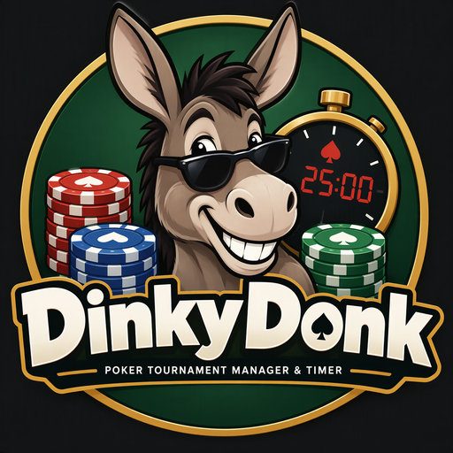

#  
> A fully-functional, easy-to-use, free and open-source desktop poker tournament manager and timer built with Tauri, React, Rust and Vite

## Features
- **FREE AND OPEN-SOURCE FOREVER:** This program is 100% free to use and even modify
  1. No cost to use...ever
  2. No limits...ever
  3. No signup required...ever
  4. As open-source software, you are free to view the source code and even edit it for your own use or for distribution as a modified version as long as your modification is offered under the same license as the original (copy-left, AGPL3 or later)
  
  The only way I make any money on this project is by users voluntarily [buying me a coffee](https://buymeacoffee.com/briansayles)...I have a small QR code on the timer to publicize this request, which I think is very reasonable

- **Guided Tournament Creation:** Create a new, **logical tournament structure** in seconds, by entering 
  1. Your smallest chip denomination,
  2. The number of players you expect, and
  3. Your desired tournament length

  Unlike many other apps, this one uses a curated list of blinds as its starting point, so you won't see levels like 32/64 or 48/96. The curated list will create a gradually increasing structure, if possible based on your inputs. If it can't, it will smartly remove certain levels to try to produce a tournament that meets your specifications.
- **Tournament Editor:** Every aspect of the generated tournament structure is easily configurable:
  1. Buyins, Rebuys, Addons available,
  2. Blinds schedule (edit the small blind and the big blind will auto-populate with 2x the small blind, although you can over-ride it),
  3. Chips available (typical chip colors and denominations will be pre-populated, but edit to your heart's content, including the color, denomination, text color, edge spot color and even the number of edge spots), and
  4. Payout calculation parameters
- **Blinds Schedule Analysis:** In edit mode, you'll see statistics and an evaluation of the blinds schedule:
  1. Starting stack as a multiple of the first level's big blind
  2. The number of players the schedule should be expected to support (assuming no rebuys, addons, etc...)
  3. Average percent big blind increase per level
  4. Average duration per level
  5. Aggressiveness, defined as average percent big blind increase per minute, and
  6. Aggressiveness evaluation: Slow, Balanced or Fast
- **Alarms and announcements:** Configure level-change and countdown-warning sounds, spoken announcements, volume, and speech speed
- **Your Data is Private:** All settings and tournament data are stored in a SQLite database on your local machine, meaning:
  1. The program does not need an internet connection to run,
  2. The program is not dependent on a remote server/database
  3. Your data is yours and yours alone...nothing gets shared outside of your control
  4. There is nothing you need to log into
  5. The read-only network viewer can display the timer on other devices without sharing the database file.
- **Tournament Timer / Manager:** 
  1. Run timed blind levels and breaks (play/pause, restart level, jump back/forward a level, and reset controls on screen),
  2. Shows current and upcoming blinds that are nicely animated when they change,
  3. Shows countdown progress along with animated hours/minutes/seconds progress circles,
  4. Shows a rotating message including:
      - Tournament name,
      - Staring players,
      - Total payout,
      - Players to be paid,
      - Players remaining, and
      - Average chipstack (actual and as a multiple of the big blind)
  5. Shows chips in play with animation to show when a chips will no longer be needed in the next level (they fade in and out) and animation when the chips in play change
  6. The timer screen runs in full screen mode for a more professional look
  7. The timer's background color and text color continuously and gradually changes
      - The background changes between 4 typical poker table cloth colors
      - The text color changes simultaneously using a calculated complimentary color
  8. When the timer is paused, the background color is set to grey and a 'timer paused' banner is displayed over the current blinds
  9. When the timer is running, the screen will be kept awake (good luck with that using any web-based tool on an Apple device!)
- **Buyin Management** The timer screen is your place for entering buyins, rebuys, addons, and other prize pool or chips in play additions, all via simple spinner controls
- **Payouts Management** The paytable is automatically created based on your entries in the structure editor:
  1. Percent of players to be paid, and
  2. Paytable shape (flat, balanced or top heavy)
If the paytable is allowed to be over-ridden, it can be edited on the timer screen via spinners for number to be paid and for each place's payout
- **Bustouts Management** Use the bustouts spinner on the timer screen to record bustouts
- **Tables Management** The program doesn't currently support tracking players individually, so table/seat assignments aren't feasible, but the program does show the number of tables needed with x players and x-1 players in order to be balanced, given the maximum players per table entered on the timer screen
- **Tournament Tracking:** All entries and bustouts are timestamped and recorded with pertinent details such as the elapsed tournament time and blinds at the time of bustout
- **CSV export:** Use **Export CSVs** on a tournament structure to create separate structure and results files that can be imported into 3rd party programs or services
- **Updates:** At startup, the app checks GitHub for a newer published release.
- **Local network timer viewer:** Open the active tournament's live timer in a browser on another device, without installing the desktop app on that device.
- **Local tournament director:** Control the active tournament from a browser on the same network.

## Screenshots

<p>
    
    
    
    
    
    
    
    
        
</p>

## History

This program's developer initially created SimpleTourneyManager back in 2009. That was developed as an Excel Add-In. Although that 'program' is known to still be in use by some, it's development ceased many years ago due to the complications of running Add-Ins for many.

Since then, a handful of other timer/manager programs were developed using a variety of technologies, but none were offered to the public.

Fast forward to 2026. Tools like React, Tauri, Vite, AI-assisted programming using GitHub Copilot, and remote builds using GitHub Actions make developing and delivering a cross-platform desktop program much simpler.

Tinkering that started in early November, 2026 led to full-fledged development and the initial release of DinkyDonk a few days later, and subsequent releases on the following days.

## What's in a Name?

This program's developer plays poker (shocking, I know) with a  group of friends and acquaintances  who were mostly brought together by one person. Sadly, he left us way earlier than he should have. In our games, when our old tournament timer's alarm would go off, he would say "Dinky Donk! Dinky to the Donkey! The blinds are up, _____". Why? Not really sure. But it stuck and we all still say it today. So this program is named in his honor. We all miss you, Mike!

## Installation

Visit the [Releases Page](https://github.com/briansayles/DinkyDonk/releases) to find and download the compiled version for your operating system.

## Running on Windows and macOS

DinkyDonk is not yet code-signed on Windows and not yet notarized by Apple on macOS, so both may show a warning when you open the app for the first time. 
Note that this project is open source, so the full source code is available at the project's [GitHub Repository](https://github.com/briansayles/DinkyDonk) for you and anyone else to review.

### Local storage

The database is created in the operating system's local app-data directory; its full path is shown in Settings. Existing JSON settings files are not imported, modified, or deleted. The database starts empty, and selecting a shared settings file is no longer supported. Tournament and timer-settings changes are transactional. Edits to different tournaments can be saved independently; stale edits to the same tournament or settings are rejected. After a conflict, review the latest data and retry.

### Viewing the timer on the local network

With DinkyDonk running, select an active tournament and open **Settings → Local network timer viewer**. On a device connected to the same IPv4 network, open one of the displayed HTTP addresses in a browser. The browser view is read-only and updates automatically. Select **Enable sound** in each viewer to play the desktop's configured alarms and announcements; browsers require this interaction before audio can play. Each viewer's volume slider affects only that viewer and resets on reload. Browser and device speech support can vary. The computer's firewall may need to allow incoming connections. Refresh the displayed addresses if the network changes; the port can change each time the app starts.

In the tournament list, the active tournament has a green border. A tournament's globe button makes it active and opens the network viewer in the desktop's default browser.

The network viewer displays a QR code that another device on the same network can scan to open the same address. Use **Settings → Local network timer viewer → Show QR code for browser-based timer** to hide or show it. Open the viewer using a network address, rather than localhost, to generate a shareable code.

The viewer starts automatically and does not use a password or encryption. Anyone who can reach the computer and port can see the active tournament's name, blinds, chips, timer, and aggregate entry, prize and payout information. Individual participant records are not sent. Only use it on a trusted network; firewall rules determine which devices can connect. The viewer stops when the desktop app exits.

### Controlling the tournament on the local network

Append `/td` to a displayed network address (for example, `http://192.168.1.10:60884/td`) to open the tournament director. It controls the active tournament's timer, entries, bustouts, tables, payouts, and alarm volume. Changes use the same local database and stale edits are rejected; review the refreshed data and retry if a conflict is reported. Timer alarms continue to play on the desktop.

Use the count spinner buttons (or arrow keys) to adjust buy-ins and bustouts; direct typing is disabled for those counts.

**The director has no password and uses unencrypted HTTP. Anyone who can reach the port can control the tournament and read the active tournament's participant records.** Use it only on a trusted network and restrict access with firewall rules.

### Windows

You may see a Windows Defender SmartScreen warning.

Click "More info" → "Run anyway" to proceed.

### MacOS

MacOS may block the app the first time you open it. You can allow it in one of two ways:

1. Go to System Settings → Privacy & Security, scroll down and click "Open Anyway" next to the DinkyDonk message. Then open the app again and confirm.
2. Run this command in the Terminal:

       xattr -dr com.apple.quarantine /Applications/DinkyDonk.app


## Support Future Development

If you find DinkyDonk useful, please consider supporting its author on [Buy Me a Coffee](https://www.buymeacoffee.com/briansayles). Any donation would be greatly appreciated and would help to fuel continued development.

<p align="center">
  <a href="https://www.buymeacoffee.com/briansayles">
    
  </a>
</p>

## License

Copyright (C) 2026 Brian Sayles.

DinkyDonk is licensed under the [GNU Affero General assets License, version 3 or later](public/LICENSE) (AGPL-3.0-or-later).

## Development

Install dependencies, then run the frontend development server:

```sh
yarn install
yarn dev
```

The network viewer and director use the built frontend assets even in desktop development mode. `yarn tauri dev` builds them before starting; after editing them or shared timer code, restart it to rebuild the assets.

Build the frontend:

```sh
yarn build
```

Build the desktop application and installers:

```sh
yarn tauri build
```

See the [Tauri prerequisites](https://tauri.app/start/prerequisites/) for the platform-specific tools needed to build desktop packages.

## Built with

<p align="center">
  <a href="https://tauri.app/">
    
  </a>
  &nbsp;&nbsp;&nbsp;
  <a href="https://react.dev/">
    
  </a>
  &nbsp;&nbsp;&nbsp;
  <a href="https://vite.dev/">
    
  </a>
</p>
