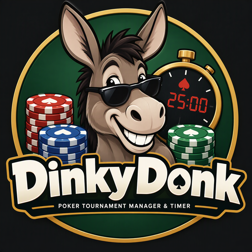

> A fully-functional yet easy-to-use poker tournament timer and manager

<p align="center">
  
</p>

DinkyDonk is a free and open-source desktop poker tournament timer and manager built with Tauri, React, and Vite.

## License

Copyright (C) 2026 Brian Sayles.

DinkyDonk is licensed under the [GNU Affero General Public License, version 3 or later](./LICENSE) (AGPL-3.0-or-later).

## Optional support

If you find DinkyDonk useful, you can optionally support its author on [Buy Me a Coffee](https://www.buymeacoffee.com/briansayles):

<p align="center">
  <a href="https://www.buymeacoffee.com/briansayles">
    
  </a>
</p>

## Features

- **Tournament timer:** Run timed blind levels and breaks, see current and upcoming blinds, and follow countdown progress.
- **Timer controls:** Play and pause, reset or restart a level, jump between levels, and use fullscreen mode.
- **Chip display:** Track chips in use and show chip color-ups as levels change.
- **Tournament structures:** Create and edit buy-in, rebuy, and add-on options; chip inventories; blind schedules; and players-per-table limits.
- **Copy structures:** Duplicate a structure's configuration without carrying over timer state, entry counts, bustouts, or payouts.
- **Tournament tracking:** Record entries and bustouts, calculate prize pools and chips in play, configure payouts, and estimate table assignments.
- **Shared-folder updates:** Store tournament data and timer preferences in a selected settings directory. Open app instances check for changes about once per second, making it possible to display the same tournament on multiple devices when they share that directory.
- **Alarms and announcements:** Configure level-change and countdown-warning sounds, spoken announcements, volume, and speech speed.
- **Keep-awake support:** Keep the display and system awake while the timer is visible.

## Development

Install dependencies, then run the frontend development server:

```sh
yarn install
yarn dev
```

Build the frontend:

```sh
yarn build
```

Build the desktop application and installers:

```sh
yarn tauri build
```

See the [Tauri prerequisites](https://tauri.app/start/prerequisites/) for the platform-specific tools needed to build desktop packages.

## Built with

<p align="center">
  <a href="https://tauri.app/">
    
  </a>
  &nbsp;&nbsp;&nbsp;
  <a href="https://react.dev/">
    
  </a>
  &nbsp;&nbsp;&nbsp;
  <a href="https://vite.dev/">
    
  </a>
</p>
